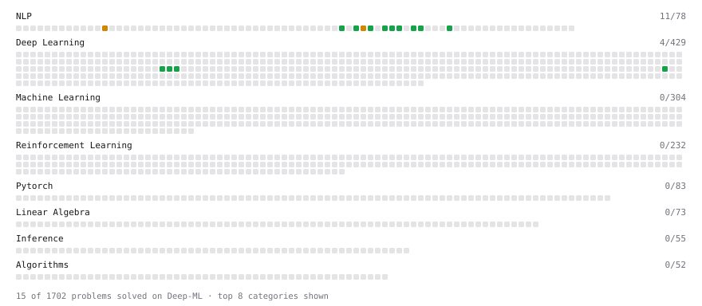

# Deep-ML

My machine learning practice from [Deep-ML](https://www.deep-ml.com). Every solution here was written by hand.

**23** solved · 18 problems · 1 labs · 4 math

[**Browse the interactive portfolio**](https://will-larkin.github.io/deep-ml/) to replay this filling in over time.

## Problems

| | Difficulty | Solved | |
| --- | --- | --- | --- |
| [Add Positional Embeddings to Token Embeddings](https://www.deep-ml.com/problems/946) | easy | 2026-10-27 | [solution](problems/0946-add-positional-embeddings-to-token-embeddings) |
| [Average Negative Log-Likelihood for Bigram Model](https://www.deep-ml.com/problems/986) | easy | 2026-10-28 | [solution](problems/0986-average-negative-log-likelihood-for-bigram-model) |
| [BPE Decode Token IDs to Text](https://www.deep-ml.com/problems/951) | easy | 2026-10-07 | [solution](problems/0951-bpe-decode-token-ids-to-text) |
| [Build Bigram Count Matrix from Words](https://www.deep-ml.com/problems/983) | easy | 2026-10-28 | [solution](problems/0983-build-bigram-count-matrix-from-words) |
| [Calculate Vocabulary Size from Token List](https://www.deep-ml.com/problems/953) | easy | 2026-10-03 | [solution](problems/0953-calculate-vocabulary-size-from-token-list) |
| [Construct Next-Token Prediction Targets](https://www.deep-ml.com/problems/954) | easy | 2026-10-28 | [solution](problems/0954-construct-next-token-prediction-targets) |
| [Dot Product Calculator](https://www.deep-ml.com/problems/83) | easy | 2026-10-29 | [solution](problems/0083-dot-product-calculator) |
| [Embedding Layer as One-Hot Matrix Multiplication](https://www.deep-ml.com/problems/947) | easy | 2026-10-28 | [solution](problems/0947-embedding-layer-as-one-hot-matrix-multiplication) |
| [Generate Input-Target Batches for Language Model Training](https://www.deep-ml.com/problems/1080) | easy | 2026-10-28 | [solution](problems/1080-generate-input-target-batches-for-language-model-training) |
| [Laplace Smoothing for Bigram Probabilities](https://www.deep-ml.com/problems/987) | easy | 2026-10-28 | [solution](problems/0987-laplace-smoothing-for-bigram-probabilities) |
| [Pad and Truncate Tokenized Sequences](https://www.deep-ml.com/problems/1059) | easy | 2026-10-28 | [solution](problems/1059-pad-and-truncate-tokenized-sequences) |
| [Replace Token Pair in BPE Sequences](https://www.deep-ml.com/problems/949) | easy | 2026-10-03 | [solution](problems/0949-replace-token-pair-in-bpe-sequences) |
| [Sliding Window Text Dataset Generator](https://www.deep-ml.com/problems/944) | easy | 2026-10-28 | [solution](problems/0944-sliding-window-text-dataset-generator) |
| [Token Embedding Lookup Table](https://www.deep-ml.com/problems/945) | easy | 2026-10-23 | [solution](problems/0945-token-embedding-lookup-table) |
| [Vector Element-wise Sum](https://www.deep-ml.com/problems/121) | easy | 2026-10-29 | [solution](problems/0121-vector-element-wise-sum) |
| [BPE Encode Text Using Merge Table](https://www.deep-ml.com/problems/950) | medium | 2026-10-07 | [solution](problems/0950-bpe-encode-text-using-merge-table) |
| [Byte Pair Encoding (BPE) Tokenizer](https://www.deep-ml.com/problems/380) | medium | 2026-10-07 | [solution](problems/0380-byte-pair-encoding-bpe-tokenizer) |
| [Train Bigram Language Model as a Neural Network](https://www.deep-ml.com/problems/988) | medium | 2026-10-29 | [solution](problems/0988-train-bigram-language-model-as-a-neural-network) |

## Labs

| | Difficulty | Solved | |
| --- | --- | --- | --- |
| [Build a Tokenizer for Language Modeling](https://www.deep-ml.com/labs/19) | medium | 2026-10-27 | [solution](labs/0019-build-a-tokenizer-for-language-modeling) |

## Math

| | Difficulty | Solved | |
| --- | --- | --- | --- |
| [Matrix Basics](https://www.deep-ml.com/math-problems/9) | easy | 2026-10-28 | [solution](math/0009-matrix-basics) |
| [Vector Operations](https://www.deep-ml.com/math-problems/7) | easy | 2026-10-28 | [solution](math/0007-vector-operations) |
| [Matrix Multiplication](https://www.deep-ml.com/math-problems/10) | medium | 2026-10-29 | [solution](math/0010-matrix-multiplication) |
| [Vector Norms and Linear Independence](https://www.deep-ml.com/math-problems/8) | medium | 2026-10-29 | [solution](math/0008-vector-norms-and-linear-independence) |

---

_This file is regenerated by Deep-ML on every push._
